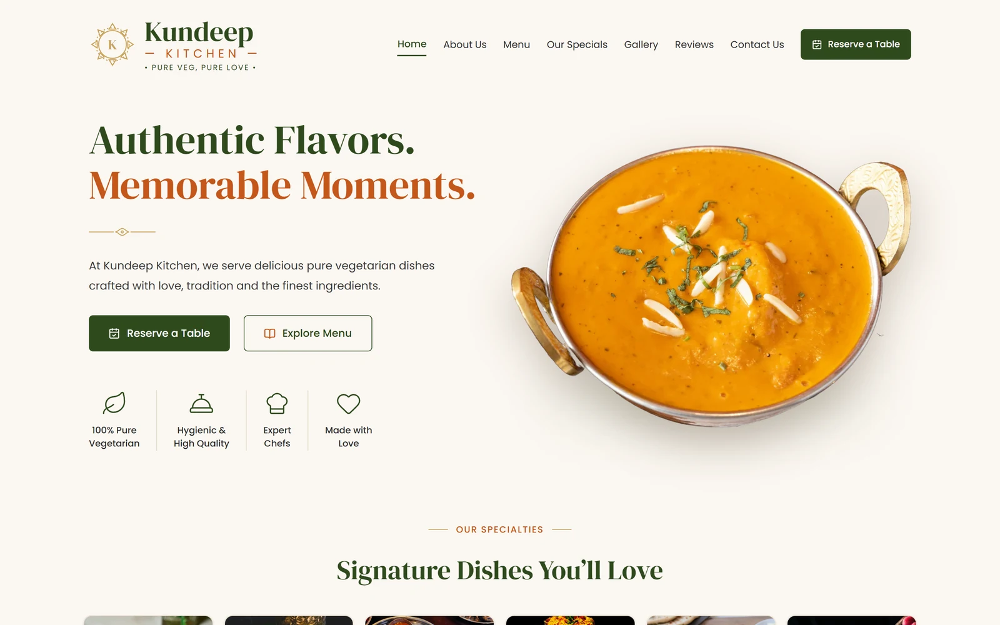
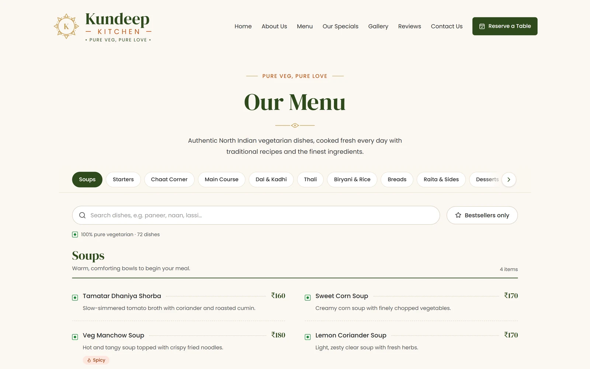

# Kundeep Kitchen — Restaurant Website Template

A warm, appetising website for a pure-vegetarian restaurant, built with Next.js 16, React 19, TypeScript and Tailwind CSS v4. It has a home page with signature dishes, an about story, a gallery and guest reviews, a full menu page with search and filters, and a table-booking form that sends reservations to WhatsApp.

**[Live demo](https://kundeep-kitchen.codespanda.com/)** · **[Template page on CodesPanda](https://codespanda.com/templates/kundeep-kitchen)**



## Features

- **Home page** — hero with Reserve a Table and Explore Menu buttons, trust badges, signature dishes, about section, photo gallery, guest reviews and a closing reservation band.
- **Menu page** (`/menu`) — 11 categories and 72 dishes, sticky category tabs, live search, a Bestsellers-only filter, prices, and tags such as Bestseller, Chef’s Special, Spicy and New.
- **Table booking** — Reserve a Table opens a booking form (name, phone, date, time, guests, occasion, requests). Submitting it opens WhatsApp with the booking filled in for the restaurant’s number, so no backend is needed.
- **Fully responsive**, from phones to wide desktops.
- **Static export** — builds to plain HTML, CSS and JS that can be hosted anywhere, including GitHub Pages.



## Tech stack

- [Next.js 16](https://nextjs.org) (App Router, static export)
- React 19 and TypeScript
- [Tailwind CSS v4](https://tailwindcss.com)
- [lucide-react](https://lucide.dev) icons
- Fonts: DM Serif Display and Poppins via `next/font/google`

## Getting started

You need Node.js 20.9 or newer (the deploy workflow uses Node 24).

```bash
npm install
npm run dev
```

Open [http://localhost:3000](http://localhost:3000). Pages reload as you edit.

| Command | What it does |
| --- | --- |
| `npm run dev` | Start the development server |
| `npm run build` | Build the static site into `out/` |
| `npm run lint` | Run ESLint |

## Project structure

```text
src/
  app/
    layout.tsx           # Fonts, page metadata, reservation provider
    page.tsx             # Home page
    menu/page.tsx        # Menu page
    globals.css          # Tailwind v4 theme (colors, fonts)
  components/
    Header.tsx  Hero.tsx  Specialties.tsx  About.tsx  Gallery.tsx
    Reviews.tsx  CtaBanner.tsx  Footer.tsx  NewsletterForm.tsx
    menu/                # MenuBrowser (tabs, search, filters), VegMark
    reservation/         # Booking dialog, provider and Reserve button
  data/
    site.ts              # Contact details, nav links, dishes, gallery, reviews
    menu.ts              # Menu categories, dishes, prices and tags
  lib/
    image-loader.ts      # Adds the base path to images in the static export
public/images/           # Dish, gallery and guest photos
scripts/
  flatten-prefetch.mjs   # Post-build fix so prefetch files load on static hosts
```

## Make it your own

Most content lives in two data files, so you rarely need to touch the components.

**Restaurant details** — edit `src/data/site.ts`:

- `contact`: phone number, email, address and opening hours. The phone number is also where WhatsApp bookings are sent.
- `navLinks`: the header and footer links.
- `dishes`, `aboutPoints`, `galleryImages`, `reviews`: the home page sections.

**Menu** — edit `src/data/menu.ts`. Each category has an `id`, `name`, `description` and a list of `items`:

```ts
{ name: "Paneer Tikka", description: "Chargrilled in the tandoor.", price: 320, tags: ["bestseller"] }
```

Prices are numbers in rupees. Add `priceNote` for an extra price line (for example `"Butter +₹10"` or half/full portions), and `tags` for `"bestseller"`, `"chef"`, `"spicy"` or `"new"`. Search, the Bestsellers filter and the dish count update automatically. The included dishes and prices are sample content, so replace them before launch.

**Photos** — replace the files in `public/images/`, keeping the same names, or update the paths in `src/data/site.ts`.

**Colors** — the palette is defined in the `@theme` block of `src/app/globals.css` (`cream`, `sand`, `forest`, `clay`, `gold` and so on). Change a value there and it updates everywhere.

**Title and description** — edit `metadata` in `src/app/layout.tsx`.

**Newsletter** — the footer form only shows a thank-you message. Connect it to a provider such as Mailchimp or Formspree in `src/components/NewsletterForm.tsx`.

## Deployment

The site is a static export (`output: "export"` in `next.config.ts`), so `npm run build` writes a ready-to-host site to `out/`.

**GitHub Pages** — `.github/workflows/deploy.yml` builds and deploys on every push to `main`:

1. In the repository, go to **Settings → Pages** and set **Source** to **GitHub Actions**.
2. Push to `main`. The workflow sets `PAGES_BASE_PATH` automatically: `/your-repo` for a project site, or empty for a custom domain or user site.
3. To use a custom domain, add it under **Settings → Pages → Custom domain**.

**Other static hosts** (Netlify, Vercel, Cloudflare Pages, any web server) — run `npm run build` and upload the `out/` folder. Leave `PAGES_BASE_PATH` unset unless the site lives in a sub-folder.

## License

[MIT](LICENSE) — free to use for personal and commercial projects, including client work. Keep the copyright notice in the LICENSE file; no other attribution is required.

The photos in `public/images/` are included for the demo. Check you have the rights to any images you publish, or replace them with your own.

## Credits

Designed and built by [CodesPanda](https://codespanda.com). Browse more free templates at [codespanda.com/templates](https://codespanda.com/templates).
